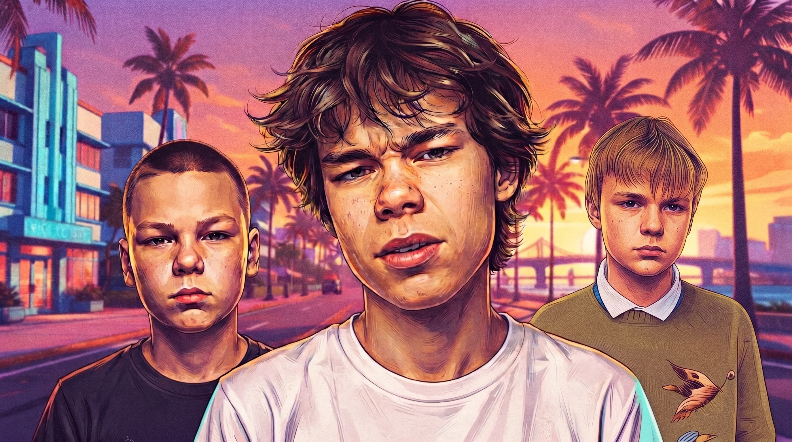

# Grand Theft Olga Gelendzhik Stories 

3D-игра в открытом мире на Three.js, сочетающая неон и атмосферу Vice City / GTA VI с подачей меню и экранов загрузки в стиле GTA IV. Работает прямо в браузере без сборки и бэкенда.
✨ Особенности

    3D-мир и радар: городские кварталы, дороги, набережная, пляж, океан, гараж и динамическая миникарта с маркерами.

    Транспорт и угон (F): езда на питбайке, выход пешком, угон гражданских машин и патрулей Полиции.

    Физика и трюки: дрифт с комбо-очками, вилли, нитро, переключение камеры (C).

    Миссии и NPC: заказчики в городе (E) и меню миссий (M) — доставка пирожков, угон авто в гараж, уход от погони.

    Розыск и ДПС: звёзды розыска и преследование патрульными машинами.

    Гараж: улучшение характеристик питбайка, смена цвета корпуса и неоновой подсветки снизу (underglow).

                                     УПРАВЛЕНИЕ 

                                     WASD / Стрелки — управление транспортом или движение пешком

F — сесть / выйти / угнать транспорт

SPACE — дрифт / прыжок

SHIFT — нитро / ускорение / бег

E — взаимодействие с NPC / запуск миссии

M — миссии и достижения

C — переключение камеры

N / U — следующий трек / вкл. или выкл. музыку

ESC — пауза
